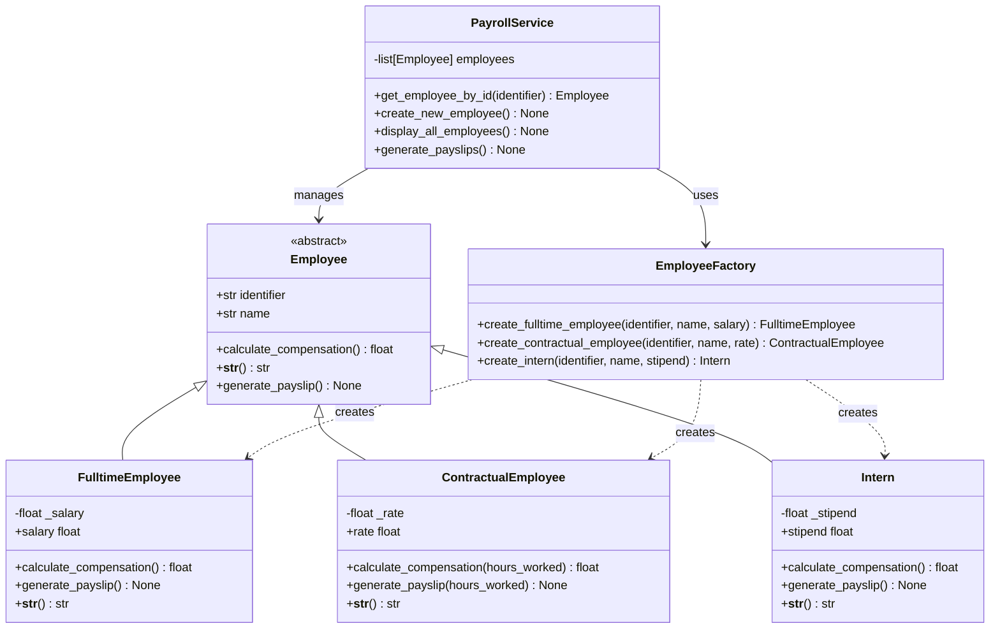

# Employee Payroll Tracker

A command-line system that computes payslips for multiple employee categories including full-time employees, contractual workers, and interns.

---

## 🚀 Overview

Managing payroll for different types of employees requires distinct compensation calculations. This project provides a unified interface to:

- **Register employees** across three categories: full-time, contractual, and interns
- **Track employee data** including IDs, names, and compensation parameters
- **Generate payslips** with category-specific calculations (salary, hourly rate, or stipend)
- **Validate inputs** to prevent duplicate IDs and invalid compensation values

The system uses object-oriented design patterns including the Factory pattern for employee creation and abstract base classes for consistent behavior across employee types.

---

## 🧠 Architecture Diagram



---

## ⚙️ Tech Stack

- **Language**: Python 3.12+
- **Build System**: Poetry (poetry-core >=2.0.0)
- **Design Patterns**: Factory Pattern, Abstract Base Classes
- **Architecture**: Object-oriented, layered (models, services, exceptions)

---

## 🛠️ Setup Instructions

### Prerequisites

- Python 3.12 or higher
- Poetry (for package management, optional for running the application)

### Installation

1. **Clone the repository**
   ```bash
   git clone <repository-url>
   cd Employee_Payroll_Tracker
   ```

2. **Create a virtual environment**
   ```bash
   python -m venv .venv
   source .venv/bin/activate  # On Windows: .venv\Scripts\activate
   ```

3. **Install dependencies**
   ```bash
   # Using Poetry (recommended)
   poetry install
   
   # Or using pip (if not using Poetry)
   pip install -e .
   ```

### Running the Application

```bash
python -m src.main
```

The application will launch an interactive menu in your terminal.

---

## 📡 Usage Documentation

This is a CLI application with an interactive menu-driven interface.

### Main Menu Operations

#### 1. Add a New Employee

Prompts for employee type and details:

- **Full-time employee**: Requires ID, name, and salary
- **Contractual employee**: Requires ID, name, and hourly rate
- **Intern**: Requires ID, name, and stipend

**Example interaction:**
```
Select desired operation (number): 1
Enter employee type (fulltime, contractual, intern): fulltime
Enter employee ID: EMP001
Enter employee name: John Doe
Enter his/her salary: 5000

Employee added successfully!
Employee Name: John Doe
Employee ID: EMP001
```

#### 2. Display All Employees

Lists all registered employees with their details.

**Example output:**
```
All employees

----------------------------------------
Employee ID:    EMP001
Employee Type:    Full-time
Employee Name:    John Doe
Employee Salary:    5000.0
----------------------------------------
Employee ID:    EMP002
Employee Type:    Contractual
Employee Name:    Jane Smith
Employee Rate:    25.0
```

#### 3. Generate Payslips

Generates a payslip for a specific employee by ID.

- **Full-time employees**: Displays salary as gross compensation
- **Contractual employees**: Prompts for hours worked, calculates rate × hours
- **Interns**: Displays stipend as gross compensation

**Example interaction:**
```
Select desired operation (number): 3
Enter employee ID: EMP002
Enter total hours worked: 40

== PAYSLIP ==
Employee ID:    EMP002
Employee Type:    Contractual
Employee Name:    Jane Smith
Employee Rate:    25.0
Hours worked:  40.0
Gross compensation: 1000.0
```

#### 0. Exit

Terminates the application.

---

## 🔄 Core Concepts

### Employee Types

1. **Full-time Employee**
   - Fixed salary compensation
   - No additional parameters needed for payslip generation
   - Salary must be non-negative

2. **Contractual Employee**
   - Hourly rate compensation
   - Requires hours worked for payslip calculation
   - Rate must be non-negative

3. **Intern**
   - Fixed stipend compensation
   - No additional parameters needed for payslip generation
   - Stipend must be non-negative

### Data Validation

- **Duplicate IDs**: Prevents multiple employees with the same identifier
- **Negative compensation**: Validates salary, rate, and stipend are >= 0
- **Invalid employee types**: Only accepts "fulltime", "contractual", or "intern"
- **Invalid menu operations**: Only accepts menu options 0-3

---

## 🚨 Important Mechanisms

### Factory Pattern

The `EmployeeFactory` class centralizes employee instantiation, ensuring consistent object creation and separating the creation logic from the business logic.

### Property Validation

All employee types use Python properties with setters to validate compensation values at assignment time, preventing negative values.

### Exception Handling

Custom exceptions provide clear error messages:
- `InvalidEmployeeTypeException`: Unknown employee type
- `EmployeeAlreadyExistsException`: Duplicate employee ID
- `EmployeeNotFoundException`: Employee ID not found during payslip generation
- `InvalidOperationSelection`: Invalid menu option

---

## ⚠️ Limitations and Future Improvements

### Current Limitations

- **In-memory storage**: Employee data is stored in a list and lost when the application exits
- **No persistence**: No database or file-based storage
- **No tax calculations**: Payslips show gross compensation only
- **No bulk operations**: Payslips must be generated one employee at a time
- **No edit/delete functionality**: Cannot modify or remove employees after creation
- **No test suite**: No automated tests are included

### Potential Future Improvements

- Add database persistence (SQLite, PostgreSQL)
- Implement tax deduction calculations
- Add bulk payslip generation for all employees
- Support for editing and deleting employee records
- Export payslips to PDF or CSV
- Add automated unit and integration tests
- Support for additional employee categories
- Date range filtering for payslip generation
- Multi-language support

---

## 🧪 Testing and Manual Testing Scenarios

### Manual Testing

Since no automated tests are currently included, manual testing can be performed through the interactive CLI:

**Test Case 1: Add Full-time Employee**
1. Run the application
2. Select option 1
3. Enter type: `fulltime`
4. Enter ID: `FT001`
5. Enter name: `Alice Johnson`
6. Enter salary: `6000`
7. Verify success message

**Test Case 2: Add Contractual Employee**
1. Select option 1
2. Enter type: `contractual`
3. Enter ID: `CT001`
4. Enter name: `Bob Williams`
5. Enter rate: `30`
6. Verify success message

**Test Case 3: Add Intern**
1. Select option 1
2. Enter type: `intern`
3. Enter ID: `IN001`
4. Enter name: `Charlie Brown`
5. Enter stipend: `1500`
6. Verify success message

**Test Case 4: Duplicate ID Prevention**
1. Attempt to add an employee with an existing ID
2. Verify `EmployeeAlreadyExistsException` is raised

**Test Case 5: Negative Value Validation**
1. Attempt to add an employee with negative salary/rate/stipend
2. Verify `ValueError` is raised

**Test Case 6: Invalid Employee Type**
1. Enter an invalid employee type (e.g., "manager")
2. Verify `InvalidEmployeeTypeException` is raised

**Test Case 7: Generate Payslip for Contractual Employee**
1. Select option 3
2. Enter contractual employee ID
3. Enter hours worked: `45`
4. Verify correct compensation calculation (rate × hours)

**Test Case 8: Non-existent Employee Payslip**
1. Select option 3
2. Enter a non-existent employee ID
3. Verify `EmployeeNotFoundException` is raised

---

## 📦 Project Structure

```
Employee_Payroll_Tracker/
├── .gitignore              # Python gitignore configuration
├── pyproject.toml          # Project metadata and Poetry configuration
├── README.md               # This file
├── .venv/                  # Virtual environment (excluded from git)
└── src/
    ├── __pycache__/        # Python bytecode cache (excluded from git)
    ├── exceptions.py       # Custom exception definitions
    ├── main.py             # Application entry point and CLI interface
    ├── models/
    │   ├── __pycache__/    # Model bytecode cache
    │   ├── base_employee.py          # Abstract base class for employees
    │   ├── contractual_employee.py   # Contractual employee implementation
    │   ├── employee_factory.py       # Factory for employee creation
    │   ├── fulltime_employee.py      # Full-time employee implementation
    │   └── intern.py                 # Intern implementation
    └── services/
        ├── __pycache__/    # Service bytecode cache
        └── payroll_service.py        # Business logic for payroll operations
```

### Key Files

- **src/main.py**: Entry point with interactive menu system
- **src/exceptions.py**: Custom exception classes for error handling
- **src/models/base_employee.py**: Abstract base class defining employee interface
- **src/models/employee_factory.py**: Factory pattern implementation for employee creation
- **src/models/fulltime_employee.py**: Full-time employee with salary-based compensation
- **src/models/contractual_employee.py**: Contractual employee with hourly rate compensation
- **src/models/intern.py**: Intern with stipend-based compensation
- **src/services/payroll_service.py**: Service layer managing employee data and operations

---

## 👨‍💻 Author and License

**Author**: furahayves  
**Email**: yvesderricks@gmail.com

**License**: Not specified
