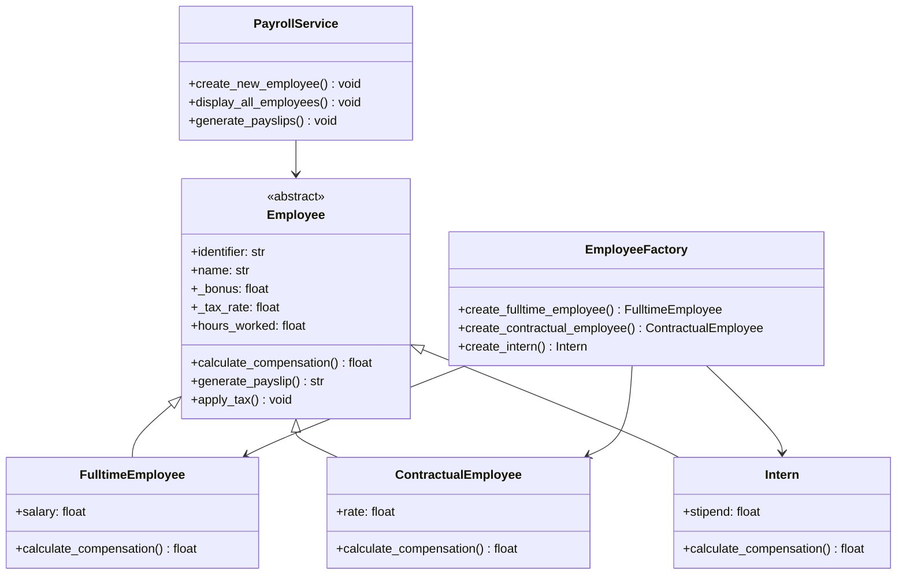

# Employee Payroll Tracker

A command-line payroll management system that computes payslips for multiple employee categories including full-time employees, contractual workers, and interns.

---

## 📋 Overview

The Employee Payroll Tracker is a Python-based CLI application designed to streamline payroll calculations for organizations with diverse workforce types. The system provides a simple interactive menu for managing employee records and generating detailed payslips with accurate tax computations.

Key capabilities include:

- Support for three employee types: full-time, contractual, and intern
- Flexible compensation calculation based on employment type
- Automatic tax computation with configurable tax rates
- Bonus management across all employee categories
- In-memory employee record storage and retrieval
- Input validation with user-friendly error messages
- Clean, object-oriented architecture using inheritance and factory patterns

---

## 🏗️ Architecture

The application follows a layered architecture with clear separation of concerns:



---

## 🛠️ Tech Stack

- **Language**: Python 3.12+
- **Build System**: Poetry
- **Architecture Pattern**: Object-Oriented Design (OOP)
- **Design Patterns**: Factory Pattern, Template Method Pattern
- **Dependencies**: None (pure Python standard library)

---

## ⚙️ Setup Instructions

### Prerequisites

- Python 3.12 or higher installed on your system
- Poetry (optional, for build management)

### Installation

1. Clone the repository:

```bash
git clone <repository-url>
cd Employee_Payroll_Tracker
```

2. Create a virtual environment (recommended):

```bash
python -m venv .venv
source .venv/bin/activate  # On Windows: .venv\Scripts\activate
```

3. The project has no external dependencies, so no package installation is required.

### Running the Application

Execute the application using Python's module runner:

```bash
python -m src.main
```

The application will launch an interactive menu in your terminal.

---

## 📖 Usage Guide

### Main Menu

Upon launching, you will see the operations menu:

```
=== Employee Payroll Tracker ===

Operations Menu
1. Add a new employee
2. Display all employees
3. Generate payslips
0. Exit
```

### Adding an Employee

Select option `1` to add a new employee. You will be prompted for:

1. **Employee Type**: Enter `fulltime`, `contractual`, or `intern`
2. **Employee ID**: A unique identifier (e.g., `E001`)
3. **Employee Name**: The employee's full name
4. **Bonus**: A positive whole number
5. **Tax Rate**: A percentage between 1 and 100
6. **Type-specific field**:
   - Full-time: salary (positive whole number)
   - Contractual: hourly rate (positive whole number)
   - Intern: stipend (positive whole number)

**Example session for a contractual employee:**

```
Select desired operation (number): 1

Enter employee type (fulltime, contractual, intern): contractual
Enter employee ID: E001
Enter employee name: Derick Dukundane
Enter the bonus: 45000
Enter the tax rate percentage (1-100): 12
Enter the rate: 24

Employee added successfully!
Employee Name: Derick Dukundane
Employee ID: E001
```

### Displaying All Employees

Select option `2` to view all registered employees:

```
Select desired operation (number): 2

All employees

----------------------------------------
Employee ID:    E001
Employee Type:    Contractual
Employee Name:    Derick Dukundane
Employee Rate:    24
```

### Generating Payslips

Select option `3` to generate a payslip for a specific employee:

1. Enter the employee ID
2. For contractual employees only: enter the total number of hours worked
3. The system calculates and displays the payslip

**Example session:**

```
Select desired operation (number): 3

Enter employee ID: E001
Enter the total number of hours: 75

== PAYSLIP ==
Employee ID:    E001
Employee Type:    Contractual
Employee Name:    Derick Dukundane
Employee Rate:    24
Hours worked:  75
Gross compensation: 1800
Bonus: 45000
Tax: 216.0
Net pay: 1584.0
```

### Exiting the Application

Select option `0` to exit the program gracefully.

---

## 🔄 Important Workflows

### Compensation Calculation Logic

Each employee type calculates gross compensation differently:

- **Full-time Employee**: Fixed salary amount

   ```
   Gross compensation = salary
   ```

- **Contractual Employee**: Hourly rate multiplied by hours worked

   ```
   Gross compensation = rate × hours_worked
   ```

- **Intern**: Fixed stipend amount
   ```
   Gross compensation = stipend
   ```

### Tax Calculation

Tax is applied uniformly across all employee types:

```
Tax amount = gross compensation × (tax_rate / 100)
Net pay = gross compensation + bonus - tax amount
```

### Input Validation

The application enforces strict input validation:

- **Bonus**: Must be a positive whole number greater than 0
- **Tax Rate**: Must be a number between 1 and 100 (inclusive)
- **Salary/Rate/Stipend**: Must be positive whole numbers greater than 0
- **Employee ID**: Must be unique (duplicate IDs are rejected)
- **Employee Type**: Must be one of `fulltime`, `contractual`, or `intern`

Invalid inputs trigger clear error messages and prompt for re-entry.

### Employee Creation Workflow

1. User selects employee type from the three supported categories
2. System validates the employee type
3. User provides employee ID (validated for uniqueness)
4. User provides name (no validation)
5. User provides bonus (validated as positive number)
6. User provides tax rate (validated as 1-100)
7. Based on type, user provides salary/rate/stipend (validated as positive)
8. EmployeeFactory creates the appropriate employee instance
9. Employee is added to the in-memory registry
10.   Success confirmation is displayed

---

## ⚠️ Limitations

- **Data Persistence**: Employee records are stored in memory only. All data is lost when the application exits.
- **Single Session**: Only one payroll session can be active at a time.
- **No Batch Operations**: Payslips must be generated individually for each employee.
- **No Data Export**: Payslips are displayed on-screen only; there is no file export or printing capability.
- **No Edit/Delete**: Once an employee is added, their information cannot be modified or removed.
- **Manual Input**: All data must be entered manually; there is no file import capability.
- **No Authentication**: The application has no user authentication or access control.
- **Limited Validation**: Name fields are not validated for format or length.

---

## 🚀 Future Improvements

Potential enhancements for future versions:

- Add database persistence (SQLite, PostgreSQL) to store employee records permanently
- Implement employee edit and delete functionality
- Add batch payslip generation for multiple employees
- Support payslip export to PDF or CSV formats
- Add file import for bulk employee data loading
- Implement user authentication and role-based access control
- Add support for additional employee types (e.g., commission-based, part-time)
- Include payroll history and audit trails
- Add reporting features (payroll summaries, tax reports)
- Implement configuration file support for default tax rates and bonuses
- Add unit and integration tests
- Support multiple currencies and locale-specific formatting

---

## 🧪 Testing

The project currently does not include automated tests. Manual testing can be performed by:

1. Running the application with `python -m src.main`
2. Testing each employee type (fulltime, contractual, intern)
3. Verifying input validation with invalid inputs (negative numbers, non-numeric values, out-of-range percentages)
4. Testing duplicate employee ID handling
5. Generating payslips for each employee type
6. Verifying tax calculations manually

---

## 📁 Project Structure

```
Employee_Payroll_Tracker/
├── pyproject.toml          # Project metadata and build configuration
├── README.md               # This file
├── .gitignore              # Git ignore rules
└── src/
    ├── main.py             # Application entry point and menu system
    ├── exceptions.py       # Custom exception classes
    ├── utils.py            # Input validation utilities
    ├── models/
    │   ├── base_employee.py           # Abstract base class for all employees
    │   ├── fulltime_employee.py      # Full-time employee implementation
    │   ├── contractual_employee.py   # Contractual employee implementation
    │   ├── intern.py                 # Intern implementation
    │   └── employee_factory.py      # Factory for creating employee instances
    └── services/
        └── payroll_service.py        # Business logic for payroll operations
```

### File Descriptions

- **src/main.py**: Contains the main loop and interactive menu. Handles user input routing and operation selection.
- **src/exceptions.py**: Defines custom exceptions: `InvalidEmployeeTypeException`, `EmployeeAlreadyExistsException`, `InvalidOperationSelection`, and `EmployeeNotFoundException`.
- **src/utils.py**: Provides reusable input validation functions: `input_positive_number()` and `input_percentage()`.
- **src/models/base_employee.py**: Abstract base class defining the common interface and properties for all employee types.
- **src/models/fulltime_employee.py**: Concrete implementation for full-time employees with salary-based compensation.
- **src/models/contractual_employee.py**: Concrete implementation for contractual employees with hourly rate-based compensation.
- **src/models/intern.py**: Concrete implementation for interns with stipend-based compensation.
- **src/models/employee_factory.py**: Factory class with static methods for creating different employee types.
- **src/services/payroll_service.py**: Service layer containing employee management and payslip generation logic.

---

## Design Decisions

### Object-Oriented Design

The application uses inheritance to share common functionality (bonus, tax calculation, payslip generation) while allowing each employee type to implement its own compensation calculation logic.

### Factory Pattern

The `EmployeeFactory` centralizes employee creation logic, making it easy to add new employee types in the future without modifying existing code.

### In-Memory Storage

The current implementation uses simple Python lists and dictionaries for storage. This keeps the application lightweight and dependency-free but limits data persistence.

### Input Validation

Comprehensive input validation is implemented at the utility level to ensure data integrity and provide clear user feedback before object creation.

---

## Error Handling

The application handles errors gracefully with custom exceptions:

- **InvalidEmployeeTypeException**: Raised when an unsupported employee type is entered
- **EmployeeAlreadyExistsException**: Raised when attempting to add an employee with a duplicate ID
- **EmployeeNotFoundException**: Raised when attempting to generate a payslip for a non-existent employee
- **InvalidOperationSelection**: Raised when an invalid menu option is selected
- **ValueError**: Raised for invalid numeric inputs (handled by validation utilities)

All errors are caught and displayed with user-friendly messages without crashing the application.

---

## Author

**furahayves**  
Email: yvesderricks@gmail.com

---

## License

Please refer to the project repository for license information.
